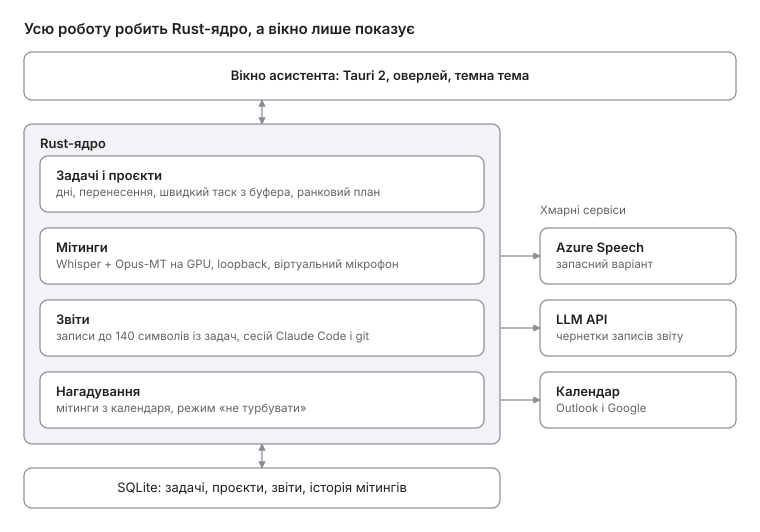
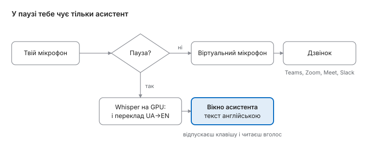

# Асистент для Windows: повний план

25 листопада 2026 · копія документа «Асистент для Windows: повний план» (оригінал: https://claude.ai/artifact/258cu9Rh8vuJ6wLjAtAPcA)

## Огляд

Це робочий асистент для Windows на Rust. Він живе в маленькому напівпрозорому вікні поверх усіх програм і закриває три задачі: задачі по днях, звіт для Upwork і підказки з перекладом на мітингах.

Ключові вимоги:

- **Вікно:** близько 1/8 екрана, стоїть там, куди його перетягнули, темна тема Windows 11. У неактивному стані воно напівпрозоре й пропускає мишку, а активним стає за хоткеєм із налаштувань. Під час демонстрації екрана його не видно ніде.
- **Задачі:** кожна задача прив'язана до проєкту або замовника. Їх можна розподіляти й переносити по днях, незроблені автоматично переходять на наступний день. Швидкий таск створюється з буфера обміну.
- **Ранковий план і денний звіт:** зранку асистент показує план на день. Увечері він складає записи до 140 символів для Upwork на основі задач і сесій Claude Code, а час по задачах ти розподіляєш вручну.
- **Мітинги (Teams, Zoom, Meet, Slack):** живі субтитри EN→UA. Режим паузи вимикає мікрофон для всіх, крім асистента: ти кажеш фразу українською й одразу бачиш англійський переклад.
- **Інше:** нагадування про мітинги з календаря, конспект мітингу з action items, глосарій, історія мітингів із пошуком, режим «не турбувати».

Розпізнавання мовлення й переклад працюють локально на RTX 3060 12 ГБ: це безкоштовно і без інтернету. Хмара залишається запасним варіантом із перемикачем.

## Архітектура

Один процес на Rust: інтерфейс на Tauri 2, а вся логіка, звук і дані живуть у Rust-ядрі. З інтернетом воно спілкується лише з двома сервісами: розпізнавання з перекладом мовлення та LLM для звітів.

| Частина | Вибір | Чому |
| --- | --- | --- |
| Вікно і інтерфейс | Tauri 2 (WebView2) | Прозорість, always-on-top і ефект Acrylic працюють одразу, а темну тему в дусі Fluent легко зробити на HTML/CSS |
| Приховування від демонстрації | `SetWindowDisplayAffinity(WDA_EXCLUDEFROMCAPTURE)` через крейт `windows` | Працює на рівні системи, тож вікна не видно в жодній програмі для дзвінків |
| Click-through | `WS_EX_TRANSPARENT` або `set_ignore_cursor_events` у Tauri | У неактивному стані мишка проходить крізь вікно |
| Гарячі клавіші | `tauri-plugin-global-shortcut` | Клавіші призначаються в налаштуваннях |
| Дані | SQLite (`rusqlite`) | Задачі, проєкти, звіти, історія мітингів і пошук через FTS5 |
| Звук дзвінка | WASAPI loopback (`wasapi` або `cpal`) | Асистент чує співрозмовників будь-якої програми |
| Мікрофон і пауза | Віртуальний мікрофон (VB-Cable): справжній мікрофон проходить через асистента | Однаково працює в Teams, Zoom, Meet і Slack. Робимо одразу через драйвер, без натискання mute у програмах |
| Розпізнавання і переклад | Локально на GPU: Whisper large-v3-turbo (whisper-rs, CUDA) + Opus-MT en→uk (ct2rs) | RTX 3060 12 ГБ вистачає з запасом. Для паузи UA→EN на етапі 0 обираємо між large-v3 translate і turbo + Opus-MT uk→en. Запасний варіант з перемикачем у налаштуваннях: Azure Speech |
| Звіти і конспекти | LLM API (наприклад, Claude) | Записи до 140 символів і конспекти мітингів |
| Джерела для звіту | `%USERPROFILE%\.claude\projects\*\*.jsonl` + `git log` | Що робилося за день і в якому проєкті |
| Календар | Microsoft Graph і Google Calendar API | Нагадування про мітинги |

Нижче видно, як модулі пов'язані між собою.

У хмару йдуть лише звук для перекладу, текст для звіту та запити до календаря. Усі дані зберігаються локально.

## Ключові сценарії

### Режим паузи (підказка UA→EN)

Асистент чує справжній мікрофон завжди, а в дзвінок звук потрапляє лише тоді, коли пауза вимкнена. Пауза діє лише тоді, коли ти тримаєш клавішу: відпустив, і тебе знову чують.

Поки пауза увімкнена, співрозмовники тебе не чують, а асистент показує англійську фразу. Вимикаєш паузу, і твій голос знову йде в дзвінок.

### Субтитри EN→UA

1. Асистент бере звук співрозмовників через WASAPI loopback і стрімить його в сервіс розпізнавання.
2. Поки фраза ще звучить, у вікні видно частковий переклад сірим, а коли вона закінчується, з'являється остаточний білим.
3. Усе зберігається в історії мітингу, по якій потім можна шукати. Історія розрізняє лише «я» і «інші», без імен співрозмовників.

### Швидкий таск з буфера обміну

1. Копіюєш текст у месенджері і натискаєш хоткей швидкого таску.
2. Вікно стає активним і показує чернетку задачі: перший рядок стає заголовком, решта текстом.
3. Обираєш проєкт або замовника зі списку з пошуком. Останній вибраний стоїть першим.
4. За замовчуванням день сьогоднішній. Enter зберігає задачу, і вікно знову стає неактивним.

### Денний звіт для Upwork

1. Наприкінці дня асистент збирає закриті й розпочаті задачі. З етапу 2 до них додаються сесії Claude Code і коміти за день.
2. Усе це групується за проєктом і замовником.
3. Ти приблизно розподіляєш час по задачах.
4. LLM пише по одному запису до 140 символів на кожну задачу чи проєкт, а асистент показує лічильник символів.
5. Ти правиш записи й копіюєш їх по одному в Upwork.

## MVP і наступні фази

Перша робоча версія (MVP) йде в два кроки: 1a дає вікно, задачі й денний звіт, 1b додає обидва режими мітингу. Усе інше додається потім, фазами. Строки поки не ставимо, називаємо лише порядок.

### Етап 0. Перевірка ризикових місць

Робимо маленькі прототипи, щоб рано з'ясувати, чи задум взагалі працює.

- [ ] Прозоре вікно з click-through, хоткеєм і приховуванням від демонстрації екрана (перевірити в Zoom, Teams, Meet, Slack)
- [ ] Віртуальний мікрофон: асистент пропускає звук у дзвінок і вимикає його за хоткеєм
- [ ] Замір затримки потокового розпізнавання і перекладу UA→EN та EN→UA

Технічні деталі, які треба перевірити замірами:

- [ ] Модель для паузи. Whisper large-v3-turbo не навчений перекладати, тому порівнюємо два варіанти: large-v3 з режимом translate або turbo, що розпізнає українську, плюс Opus-MT uk→en. Вибираємо за швидкістю і якістю.
- [ ] Silero VAD (визначає, де в звуці мова, щоб різати субтитри по фразах) і один спільний екземпляр Whisper для субтитрів і паузи, щоб не завантажувати модель двічі.

### Етап 1a. MVP: задачі і звіт

- [ ] Вікно: неактивний і активний стан, позиція запам'ятовується, темна тема, налаштування хоткеїв і прозорості
- [ ] Проєкти і замовники
- [ ] Задачі по днях: додати, перенести, закрити, автоперенесення незроблених
- [ ] Швидкий таск з буфера обміну
- [ ] Ранковий план дня
- [ ] Денний звіт: ручний розподіл часу і чернетка записів до 140 символів, яку LLM складає з задач

### Етап 1b. MVP: мітинги

- [ ] Субтитри EN→UA (Whisper + Opus-MT en→uk)
- [ ] Режим паузи UA→EN через драйвер віртуального мікрофона (VB-Cable)

### Етап 2. Розумний звіт і календар

- [ ] Окремий ізольований модуль, що розбирає сесії Claude Code (формат може змінюватися), і аналіз `git log` за день, з прив'язкою «папка → проєкт → замовник»
- [ ] Нагадування про мітинги з календаря і звичайні нагадування
- [ ] Режим «не турбувати»
- [ ] Експорт звіту (буфер обміну, Markdown, Telegram, Slack)

### Етап 3. Мітинги додатково

- [ ] Історія мітингів із пошуком
- [ ] Глосарій імен і термінів
- [ ] Конспект мітингу з action items, які одразу стають задачами
- [ ] Швидке додавання задачі звичайним текстом, наприклад «завтра о 10…»

### На майбутнє

Інтеграція з Clockify, контекстна підказка відповіді на мітингу, персональний словник, звіт для замовника.

## Ризики і відкриті рішення

Найбільший ризик це затримка в режимі паузи. Саме тому етап 0 починається з її заміру.

- **Затримка.** У режимі паузи переклад має з'явитися приблизно через 0,5–1 с після того, як ти відпустиш клавішу. У субтитрах затримка буде близько 1,5–3 с. Це оцінки по пам'яті, їх треба перевірити на етапі 0.
- **Віртуальний мікрофон.** У кожній програмі для дзвінків доведеться один раз вибрати його як мікрофон. Якщо асистент впаде, у дзвінку запанує тиша, тому потрібен сторож, який це помітить.
- **Приховування від демонстрації екрана.** Це працює на Windows 10 2004 і новіших. Треба перевірити в кожній програмі, бо вікна не має бути видно ні при демонстрації всього екрана, ні при демонстрації окремого вікна.
- **Вартість.** Локальне розпізнавання безкоштовне. Платити доведеться лише за LLM для звітів і, якщо увімкнеш, за хмарний запасний варіант.
- **Хмарні сесії Claude Code** не враховуємо: усі проєкти локальні, тому вистачає локальних сесій і git.

Уже вирішено:

- Як вмикати паузу: пауза діє, поки тримаєш клавішу.
- Календар: підтримуємо обидва, Outlook і Google.
